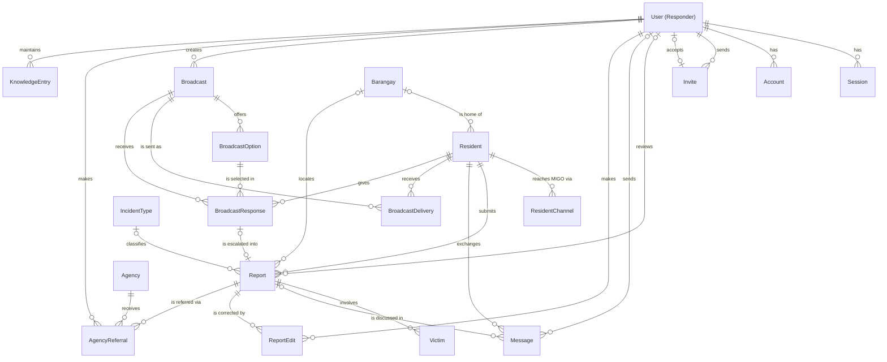
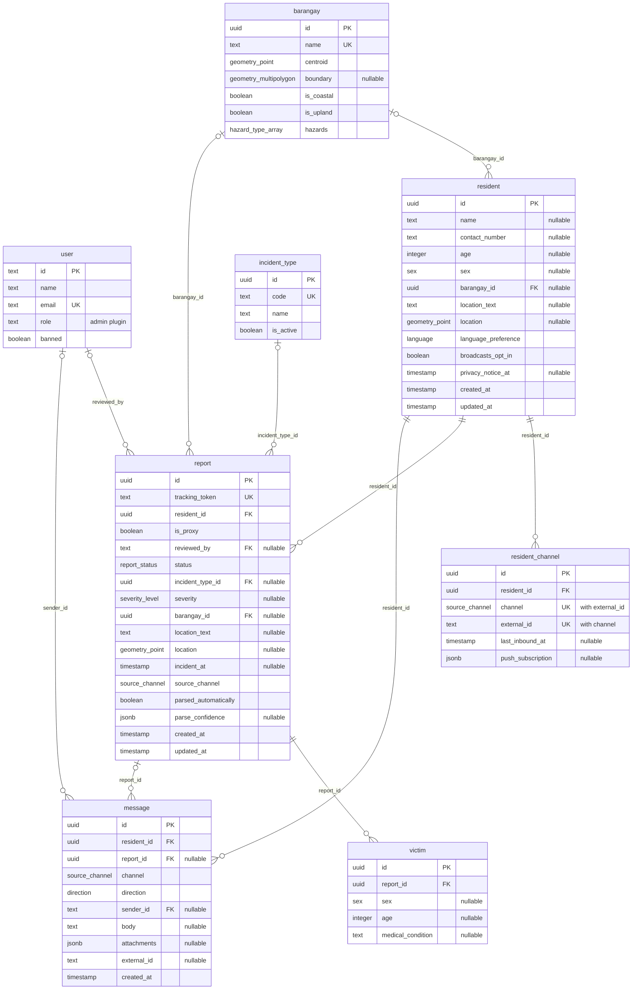

# Database

PostgreSQL 17 + PostGIS, managed by Drizzle.

- Schema: `apps/api/src/database/schema/`
- Migrations: `apps/api/drizzle/`

Update this doc with every schema change.

## Conceptual model



`Broadcast.target_barangay_ids` is a `uuid[]`, not a foreign key.

## Logical model

Better Auth tables other than `user` are omitted.



## Data dictionary

Spatial columns are PostGIS `geometry` in SRID 4326. Timestamps are UTC, without time zone.

### barangay

Miagao's barangays. Resolve locations and target broadcasts. Seeded by migration from `apps/api/scripts/build-barangays.py`, which derives the flags from PSA boundaries, Project NOAH hazard maps, and Copernicus elevation data.

| Column       | Type                     | Null | Default | Constraint | Description                         |
| ------------ | ------------------------ | ---- | ------- | ---------- | ----------------------------------- |
| `id`         | `uuid`                   | no   | random  | PK         |                                     |
| `name`       | `text`                   | no   |         | unique     | Official name                       |
| `centroid`   | `geometry(Point)`        | no   |         | GiST       | Pin when only the barangay is known |
| `boundary`   | `geometry(MultiPolygon)` | yes  |         | GiST       | Seeded from PSA/NAMRIA 2023         |
| `is_coastal` | `boolean`                | no   | `false` |            | Storm surge, gale targeting         |
| `is_upland`  | `boolean`                | no   | `false` |            | Landslide targeting                 |
| `hazards`    | `hazard_type[]`          | no   | `{}`    |            | From Project NOAH hazard maps       |

### resident

A person who has messaged MIGO. All details are optional.

| Column                | Type              | Null | Default | Constraint      | Description          |
| --------------------- | ----------------- | ---- | ------- | --------------- | -------------------- |
| `id`                  | `uuid`            | no   | random  | PK              |                      |
| `name`                | `text`            | yes  |         |                 |                      |
| `contact_number`      | `text`            | yes  |         |                 | Asked for first      |
| `age`                 | `integer`         | yes  |         | `>= 0`          |                      |
| `sex`                 | `sex`             | yes  |         |                 |                      |
| `barangay_id`         | `uuid`            | yes  |         | FK → `barangay` |                      |
| `location_text`       | `text`            | yes  |         |                 | Home address         |
| `location`            | `geometry(Point)` | yes  |         | GiST            |                      |
| `language_preference` | `language`        | no   | `tgl`   |                 |                      |
| `broadcasts_opt_in`   | `boolean`         | no   | `true`  |                 |                      |
| `privacy_notice_at`   | `timestamp`       | yes  |         |                 | Privacy notice shown |
| `created_at`          | `timestamp`       | no   | `now()` |                 |                      |
| `updated_at`          | `timestamp`       | no   | `now()` |                 | Updated by Drizzle   |

### resident_channel

A resident's identity on one platform. One resident can have several.

| Column              | Type             | Null | Default | Constraint                        | Description                      |
| ------------------- | ---------------- | ---- | ------- | --------------------------------- | -------------------------------- |
| `id`                | `uuid`           | no   | random  | PK                                |                                  |
| `resident_id`       | `uuid`           | no   |         | FK → `resident`, index            |                                  |
| `channel`           | `source_channel` | no   |         | unique (`channel`, `external_id`) |                                  |
| `external_id`       | `text`           | no   |         | unique (`channel`, `external_id`) | Messenger PSID or web session ID |
| `last_inbound_at`   | `timestamp`      | yes  |         |                                   | Messaging window check           |
| `push_subscription` | `jsonb`          | yes  |         |                                   | Web Push endpoint                |

### incident_type

Kinds of incident a report can have. Seeded by migration; admins add types and retire them with `is_active`.

| Column      | Type      | Null | Default | Constraint | Description               |
| ----------- | --------- | ---- | ------- | ---------- | ------------------------- |
| `id`        | `uuid`    | no   | random  | PK         |                           |
| `code`      | `text`    | no   |         | unique     | Used by the classifier    |
| `name`      | `text`    | no   |         |            | Display label             |
| `is_active` | `boolean` | no   | `true`  |            | Offered to the classifier |

### report

An incident report. The sender is always `resident_id`; `is_proxy` marks reports about someone else.

| Column                 | Type              | Null | Default   | Constraint                     | Description                                 |
| ---------------------- | ----------------- | ---- | --------- | ------------------------------ | ------------------------------------------- |
| `id`                   | `uuid`            | no   | random    | PK                             |                                             |
| `tracking_token`       | `text`            | no   | generated | unique                         | 128-bit, base64url; `/status/:token`        |
| `resident_id`          | `uuid`            | no   |           | FK → `resident`, index         | Always the sender                           |
| `is_proxy`             | `boolean`         | no   | `false`   |                                | About someone else                          |
| `reviewed_by`          | `text`            | yes  |           | FK → `user`                    |                                             |
| `status`               | `report_status`   | no   | `pending` | index (`status`, `created_at`) |                                             |
| `incident_type_id`     | `uuid`            | yes  |           | FK → `incident_type`, index    |                                             |
| `severity`             | `severity_level`  | yes  |           |                                |                                             |
| `barangay_id`          | `uuid`            | yes  |           | FK → `barangay`, index         |                                             |
| `location_text`        | `text`            | yes  |           |                                | As reported                                 |
| `location`             | `geometry(Point)` | yes  |           | GiST                           |                                             |
| `incident_at`          | `timestamp`       | yes  |           |                                |                                             |
| `source_channel`       | `source_channel`  | no   |           |                                |                                             |
| `parsed_automatically` | `boolean`         | no   | `false`   |                                | False for form reports                      |
| `parse_confidence`     | `jsonb`           | yes  |           |                                | Field → confidence, `parseConfidenceSchema` |
| `created_at`           | `timestamp`       | no   | `now()`   |                                |                                             |
| `updated_at`           | `timestamp`       | no   | `now()`   |                                | Updated by Drizzle                          |

### victim

A person affected by a report. No names are stored (FR9).

| Column              | Type      | Null | Default | Constraint           | Description |
| ------------------- | --------- | ---- | ------- | -------------------- | ----------- |
| `id`                | `uuid`    | no   | random  | PK                   |             |
| `report_id`         | `uuid`    | no   |         | FK → `report`, index |             |
| `sex`               | `sex`     | yes  |         |                      |             |
| `age`               | `integer` | yes  |         | `>= 0`               |             |
| `medical_condition` | `text`    | yes  |         |                      |             |

### message

Every inbound and outbound chat message. Saved before processing, so it is the fallback record.

| Column        | Type             | Null | Default | Constraint                                                        | Description                     |
| ------------- | ---------------- | ---- | ------- | ----------------------------------------------------------------- | ------------------------------- |
| `id`          | `uuid`           | no   | random  | PK                                                                |                                 |
| `resident_id` | `uuid`           | no   |         | FK → `resident`, index (`resident_id`, `created_at`)              |                                 |
| `report_id`   | `uuid`           | yes  |         | FK → `report`, index                                              |                                 |
| `channel`     | `source_channel` | no   |         | unique (`channel`, `external_id`) where `external_id` is not null |                                 |
| `direction`   | `direction`      | no   |         |                                                                   |                                 |
| `sender_id`   | `text`           | yes  |         | FK → `user`                                                       | Null: bot or resident           |
| `body`        | `text`           | yes  |         |                                                                   | Raw text                        |
| `attachments` | `jsonb`          | yes  |         |                                                                   | Location payloads, storage keys |
| `external_id` | `text`           | yes  |         | see `channel`                                                     | Platform message ID (dedup)     |
| `created_at`  | `timestamp`      | no   | `now()` |                                                                   |                                 |

## Enums

Defined as Zod enums in `packages/shared/src/enums.ts`; the `pgEnum`s are built from them.

| Enum             | Values                                                                | Used by                                                                |
| ---------------- | --------------------------------------------------------------------- | ---------------------------------------------------------------------- |
| `hazard_type`    | `flood`, `landslide`, `storm_surge`, `earthquake`, `fire`             | `barangay.hazards`                                                     |
| `sex`            | `male`, `female`                                                      | `resident.sex`, `victim.sex`                                           |
| `language`       | `hil`, `krj`, `tgl`, `eng` (ISO 639-3)                                | `resident.language_preference`                                         |
| `source_channel` | `messenger`, `web`                                                    | `resident_channel.channel`, `report.source_channel`, `message.channel` |
| `report_status`  | `pending`, `validated`, `dispatched`, `resolved`, `closed`, `invalid` | `report.status`                                                        |
| `severity_level` | `low`, `moderate`, `high`, `critical`                                 | `report.severity`                                                      |
| `direction`      | `inbound`, `outbound`                                                 | `message.direction`                                                    |

Only add values; removing or renaming one breaks older releases.

## Better Auth tables

Generated into `schema/auth.ts` by `pnpm --filter api auth:generate`; migrated by drizzle-kit. Don't edit by hand.

| Table          | Holds                                                                                  |
| -------------- | -------------------------------------------------------------------------------------- |
| `user`         | Responder accounts. `role` (`admin`, `responder`) and ban fields from the admin plugin |
| `session`      | Active sessions                                                                        |
| `account`      | Credentials per provider (password hash for email login)                               |
| `verification` | Short-lived tokens (email verification, password reset)                                |

App tables reference `user.id` (`text`). There is no separate responder table.

## Chat SDK state tables

`chat_state_*` tables belong to Chat SDK's `@chat-adapter/state-pg`, which creates them at startup. They hold expiring state (dedup, locks, subscriptions), not records.

- Not in the Drizzle schema; excluded from drizzle-kit.
- Safe to wipe.
- Never read history from them; use `message`.

## Conventions

- Tables and columns: singular `snake_case`.
- Primary keys: `uuid`. Responder FKs: `text` → `user.id`.
- No `DELETE`. FKs are `ON DELETE RESTRICT`; retire rows by status.
- Spatial columns: `geometry` (SRID 4326) via the `customType`s in `schema/columns.ts`, not Drizzle's built-in `geometry`, which drops the SRID. Points read as `{ lng, lat }`, multipolygons as GeoJSON.
- Distances in meters: cast to `geography` (`ST_Distance(a::geography, b::geography)`).
- Spatial queries: `sql` template.

  ```ts
  db.select()
    .from(barangay)
    .where(
      sql`ST_Contains(${barangay.boundary}, ST_SetSRID(ST_MakePoint(${lng}, ${lat}), 4326))`,
    );
  ```

## Migrations

```sh
pnpm db:generate   # then review the SQL in apps/api/drizzle/
pnpm db:migrate
```
